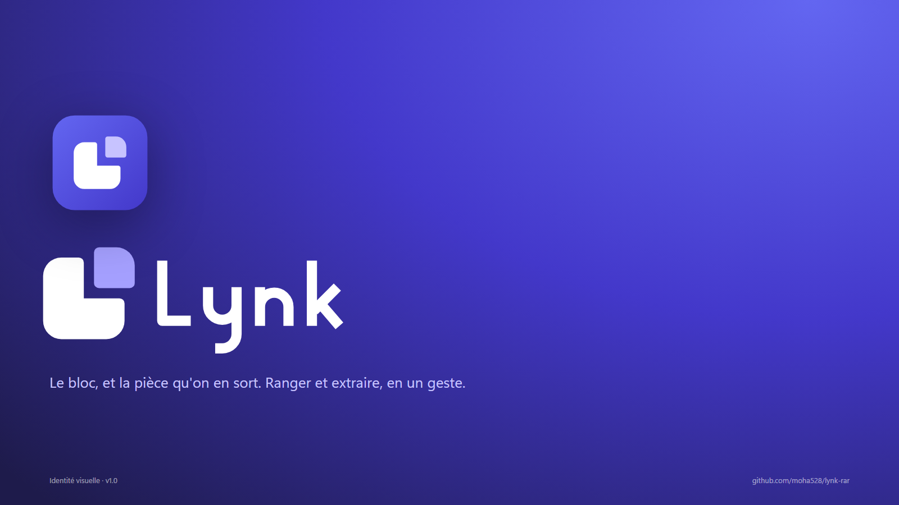

# Identité de Lynk



**L'idée.** Un bloc dont une pièce s'extrait : ensemble, ils dessinent le L de Lynk. Le bloc, c'est l'archive qui range ; la pièce sortie, c'est le fichier qu'on extrait.

La planche complète est dans [board/](board/) (`board.html`, ou les PNG `slide-1.png` à `slide-5.png`).

## Fichiers

Tous les originaux sont des SVG vectoriels purs : aucun texte, aucune image intégrée, aucun filtre.

| Fichier | Usage |
|---|---|
| `logo/lynk-symbol.svg` | Symbole en couleur, sur fond clair |
| `logo/lynk-symbol-on-dark.svg` | Symbole sur fond sombre |
| `logo/lynk-symbol-small.svg` | Coupe pour petites tailles (interstices élargis), **à 32 px et moins** |
| `logo/lynk-symbol-black.svg`, `-white.svg` | Une couleur : gravure, tampon, fond photo |
| `logo/lynk-wordmark*.svg` | Logotype seul |
| `logo/lynk-lockup-horizontal*.svg` | Symbole + logotype, version principale |
| `logo/lynk-lockup-stacked*.svg` | Version empilée, pour les formats carrés |
| `logo/lynk-app-icon.svg` | Icône d'application (tuile indigo) : source de `app/app-icon.svg` et de toutes les icônes Tauri et MSIX |
| `logo/lynk-file-icon.svg` | Icône des archives associées à Lynk (→ `app/src-tauri/icons/archive.ico`) |
| `png/` | Exports transparents 1024 px, lockups en 1200 px, carte sociale GitHub 1280 × 640 |

Après avoir modifié l'icône d'application, régénérer les icônes de l'app :

```bash
cd app && npx tauri icon app-icon.svg
```

## Construction

Grille de 256 unités :

- un bloc carré de 160 de côté, fait de deux bras égaux de 80 ;
- une pièce de 80 × 80 sortie en diagonale, avec deux interstices identiques de 20 ;
- des rayons de 36 aux angles extérieurs et de 10 aux angles intérieurs ;
- l'ensemble centré, dans une boîte de 38 à 218.

La **coupe petite taille** élargit les interstices à 28 et réduit la pièce à 72 : à 16 px, la séparation reste visible.

## Espace et tailles minimales

- **Espace de protection** : la moitié de la pièce, soit 40 unités sur 256, autour du symbole comme des lockups.
- **Symbole** : 16 px minimum. Coupe petite taille en dessous de 32 px.
- **Lockup horizontal** : 96 px de large minimum. **Lockup empilé** : 64 px.

## Couleurs

| Nom | HEX | RVB | CMJN (approx.) | Rôle |
|---|---|---|---|---|
| Indigo | `#4F46E5` | 79 70 229 | 66 69 0 10 | Bloc, couleur principale |
| Violet clair | `#8B83FF` | 139 131 255 | 45 49 0 0 | Pièce, sur fond clair |
| Lavande | `#C7C3FF` | 199 195 255 | 22 24 0 0 | Pièce, sur fond sombre ou indigo |
| Nuit | `#1E1B4B` | 30 27 75 | 60 64 0 71 | Logotype, textes, fonds sombres |

Dégradé de la tuile d'application : `#6366F1` → `#4338CA`, à 135°.

Les valeurs CMJN sont des conversions à valider avec l'imprimeur. Pantone le plus proche : environ 2725 C pour l'Indigo, à vérifier au nuancier.

**Fonds.**

- Fond clair : version en couleur.
- Fond sombre ou indigo : version `on-dark`.
- Photo ou fond chargé : version une couleur, blanche ou noire.

## Typographie

- **Logotype** : dessiné sur mesure, avec des traits réguliers, des bouts droits et des jonctions arrondies. Ne jamais le recomposer dans une police.
- **Interface et documents sous Windows** : Segoe UI Variable, la police du système.
- **Web et README** : Inter, sous licence OFL.

## À éviter

Ne pas faire tourner, déformer, recolorer (en dehors de la palette), ajouter d'ombre ou de contour, ou séparer la pièce du bloc pour un autre usage. Ne pas placer la version en couleur sur un fond chargé. La [planche 5](board/slide-5.png) montre ces cas.

## Marque

Avant tout dépôt ou usage commercial, faites vérifier la disponibilité du nom et du symbole : bases de marques (INPI, EUIPO, USPTO) et recherche d'images inversée. Ce kit ne remplace pas cette vérification.
