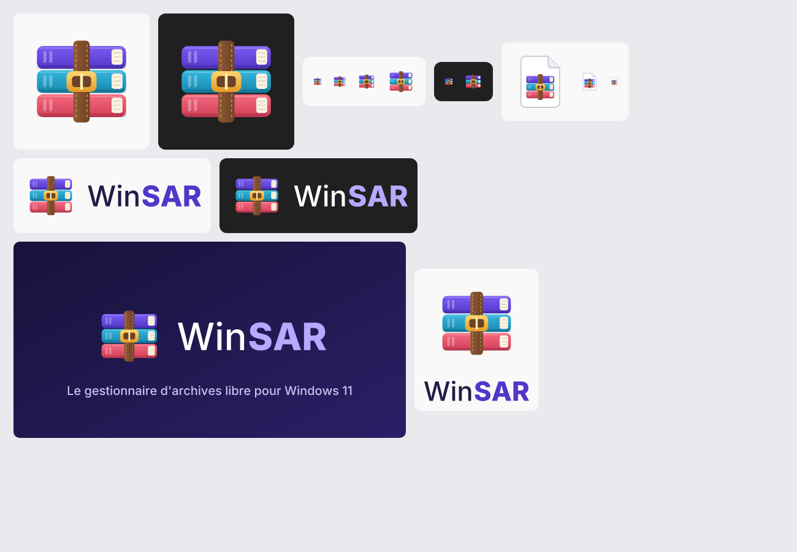

# Identité de WinSAR

**L'idée.** Trois volumes tenus par une ceinture de cuir à boucle dorée : l'archive qui range et qui serre. C'est un hommage assumé aux livres sanglés de WinRAR, redessiné pour Windows 11 : volumes arrondis, rendu Fluent, palette plus fraîche. Le dessin est original, il ne reprend aucun élément graphique de WinRAR.

**Le nom.** Win + SAR, comme Win + RAR : « RAR » voulait dire *Roshal ARchive*, du nom de son auteur.

## Fichiers

Les originaux sont des SVG vectoriels purs : pas de texte (le mot est en tracés), pas d'image intégrée, pas de filtre.

| Fichier | Usage |
|---|---|
| `logo/winsar-symbol.svg` | Symbole, à partir de 48 px |
| `logo/winsar-symbol-small.svg` | Symbole simplifié pour 16 à 32 px (sans coutures, ni lignes de pages, ni ardillon) |
| `logo/winsar-file-icon.svg`, `-small.svg` | Icône des fichiers d'archive associés à WinSAR |
| `logo/winsar-wordmark.svg`, `-on-dark.svg` | Mot seul |
| `logo/winsar-lockup-horizontal.svg`, `-on-dark.svg` | Symbole et mot côte à côte : en-têtes, README |
| `logo/winsar-lockup-stacked.svg`, `-on-dark.svg` | Symbole au-dessus du mot : formats carrés |
| `png/winsar-symbol-{16…1024}.png` | Exports ; la version simplifiée sert jusqu'à 32 px |
| `png/winsar.ico`, `png/winsar-archive.ico` | Icônes Windows multi-tailles (de 16 à 256 px), copiées dans `app/src-tauri/icons/` |
| `png/winsar-social-preview.png` | Aperçu du dépôt sur GitHub (1280 × 640) |

`app/app-icon.svg` est une copie de `logo/winsar-symbol.svg`. Après une modification, régénérez les icônes avec `npx tauri icon app-icon.svg` (dans `app/`), puis recopiez les deux `.ico` de `png/`, mieux rendus en petite taille.

## Couleurs

| Rôle | Couleur |
|---|---|
| Volume violet | `#7C5CF2` → `#5236C9` |
| Volume cyan | `#35B8E0` → `#1786AD` |
| Volume corail | `#F56B80` → `#D23E58` |
| Ceinture | `#8F5A33` → `#6E4226`, coutures `#C8915E` |
| Boucle | `#FFD772` → `#E39B24` |
| Pages | `#FBF3E4` |
| Encre du mot | `#211B45`, « SAR » en `#5236C9` ; sur fond sombre : blanc et `#B9A8FF` |

L'accent de l'application part du violet `#5236C9`. `app/src/palette.ts` le décline pour chaque thème en garantissant un contraste d'au moins 4,5:1 : texte blanc sur l'accent en clair, accent sur le fond en sombre.

## Typographie

Le mot-symbole est en [Inter](https://rsms.me/inter/) (licence SIL OFL) : « Win » en Medium, « SAR » en ExtraBold, comme le contraste de graisse de WinRAR. Les lettres sont converties en tracés.

## Règles

- **Espace libre** : autour du symbole, au moins la largeur de la ceinture.
- **Taille minimale** : 16 px, avec la version simplifiée.
- **Fonds** : le symbole va sur fond clair comme sur fond sombre ; le mot a une version pour chaque.
- **À éviter** : déformer, changer l'ordre ou les couleurs des volumes, ajouter une ombre portée, poser le symbole sur une photo chargée.
